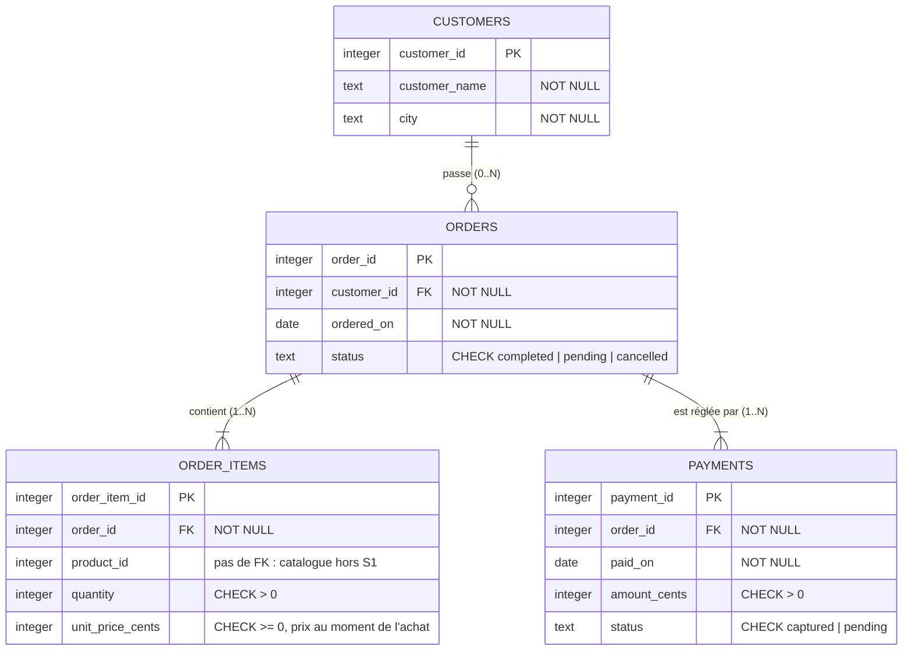

# NovaMarket S1 — Solution des missions M1 à M4

Pour tout rejouer, depuis `novamarket/` :

```bash
./s1/sql/run_all.sh
```

Les scripts sont dans [`s1/sql/`](sql/). La chaîne est rejouable : elle recrée les schémas à chaque passage. Les fichiers bruts de `s1/donnees/` ne sont jamais modifiés. Montants sources en centimes, affichés en euros.

| Script | Mission |
| --- | --- |
| `00_connexion.sql` | M2 : test de connexion |
| `01_schema.sql` | M1 / M2 : DDL (réception, rejets, métier) |
| `02_import.sql` | M2 : import CSV / NDJSON, contrôles, intégration ou rejet |
| `03_controles.sql` | M2 : comptages et journal des rejets |
| `04_indicateurs.sql` | M3 : indicateurs, rapprochement, vérifications de cohérence |
| `05_anomalies.sql` | M4 : doublons, orphelins, multiplication, statuts |
| `06_normalisation.sql` | A1 : anomalies de normalisation (exemple du planning) |

---

## M1 — Examiner les sources et modéliser

### Grain de chaque source

| Source | Grain (1 ligne =) | Identifiant | Référence vers |
| --- | --- | --- | --- |
| customers.csv | un client | `customer_id` | — |
| orders.csv | une commande | `order_id` | client (`customer_id`) |
| order_items.csv | une ligne d'article d'une commande | `order_item_id` | commande (`order_id`), produit (`product_id`) |
| payments.ndjson | une opération de paiement | `payment_id` | commande (`order_id`) |

### Relations 1–N

- 1 client → N commandes. 30 clients en ont 0.
- 1 commande → N lignes d'articles. Dans ce jeu, chaque commande en a exactement 2.
- 1 commande → N paiements, 1 ou 2 par commande : 40 commandes sont payées en deux fois.
- Articles et paiements n'ont **pas de lien direct**. Ce sont deux tables « filles » de la commande, avec des grains différents.

### Schéma relationnel annoté



Organisation en trois schémas :

```
reception.*  (tout en text + n° de ligne source)
      │  contrôles : type, valeurs autorisées, doublon, référence
      ├──► nova.*          (données typées et contraintes, ci-dessus)
      └──► rejets.journal  (source, ligne, identifiant, motif, contenu brut)
```

**Ordre d'import**, imposé par les clés étrangères : customers → orders → order_items, puis payments.

### Deux choix de conception justifiés

1. **Une réception en `text`, sans contraintes, avant l'intégration.** Si on chargeait directement dans les tables typées, une seule ligne fautive ferait échouer tout le `\copy` et on ne pourrait ni observer ni expliquer l'anomalie. Avec la réception, chaque ligne reçue garde son numéro et finit soit dans `nova`, soit dans `rejets.journal` avec sa cause. Le bilan reçus = intégrés + rejetés se vérifie automatiquement.
2. **Montants en `integer` (centimes) et prix conservé sur la ligne de commande.** Des centimes entiers évitent les erreurs d'arrondi des flottants : les sommes sont exactes et la conversion en euros n'a lieu qu'à l'affichage. `unit_price_cents` reste dans `order_items` et n'est pas pris dans un catalogue, car il reflète le prix au moment de l'achat (voir SOURCES.md).

Règle de dédoublonnage : on conserve la 1re occurrence d'un identifiant et on rejette les suivantes. Le journal distingue *doublon exact* (même contenu) et *conflit* (contenu différent).

---

## M2 — Créer et alimenter PostgreSQL

### Démarrage et connexion

```bash
cd novamarket
docker compose up -d --wait postgres
docker compose exec postgres psql -X -U atelier -d novamarket -f /s1/sql/00_connexion.sql
```

```
    base    | utilisateur | version_postgresql
------------+-------------+--------------------
 novamarket | atelier     | 17.12
```

### Scripts

- DDL : [`01_schema.sql`](sql/01_schema.sql)
- Import CSV et NDJSON : [`02_import.sql`](sql/02_import.sql). Le NDJSON est lu une ligne par document, puis contrôlé avec `pg_input_is_valid(document, 'jsonb')` avant d'extraire les champs.

### Comptages : reçus, intégrés, rejetés

| Source | Reçus | Intégrés | Rejetés | Bilan |
| --- | ---: | ---: | ---: | --- |
| customers.csv | 180 | 180 | 0 | OK |
| orders.csv | 400 | 400 | 0 | OK |
| order_items.csv | 802 | 800 | 2 | OK |
| payments.ndjson | 480 | 480 | 0 | OK |

### Journal des rejets (`rejets.journal`)

| Source | Ligne | Id | Motif | Contenu |
| --- | ---: | --- | --- | --- |
| order_items.csv | 801 | 7 | doublon exact de `order_item_id` | commande 4, produit 5, qté 3, 1 125 c |
| order_items.csv | 802 | 801 | commande inconnue (référence orpheline) | commande 9999, produit 1, qté 1, 625 c |

Après intégration, les contrôles d'intégrité donnent tous 0 : aucun article ni paiement sans commande, aucune commande sans article.

---

## M3 — Produire les indicateurs

Requêtes : [`04_indicateurs.sql`](sql/04_indicateurs.sql). **Règle appliquée :** chaque table est agrégée par commande avant toute jointure.

### Résultats

| Indicateur | Valeur |
| --- | ---: |
| Commandes `completed` | 320 |
| Commandes `pending` | 40 |
| Commandes `cancelled` | 40 |
| Clients sans commande | 30 sur 180 |
| **Montant des lignes des commandes terminées (CA)** | **26 210,00 €** |
| **Panier moyen** | **81,91 €** |

### Hypothèses

- **CA :** somme de `quantity × unit_price_cents` sur les commandes au statut `completed` uniquement. Les commandes `pending` ne sont pas finalisées, les `cancelled` sont annulées.
- **Panier moyen :** CA ÷ **nombre de commandes terminées (320)**. Diviser par le nombre de lignes d'articles, ou par le nombre de clients, donnerait un autre indicateur.
- Les paiements `pending` ne sont pas des encaissements.

### Rapprochement des paiements, sans confondre les grains

Les articles sont agrégés par commande, les paiements aussi, puis les deux résultats sont joints un pour un :

| Statut commande | Montant articles | Encaissé (`captured`) | En attente (`pending`) | Commandes en écart |
| --- | ---: | ---: | ---: | ---: |
| completed | 26 210,00 € | 26 210,00 € | 0,00 € | 0 |
| pending | 3 223,75 € | 0,00 € | 3 223,75 € | 0 |
| cancelled | 3 283,75 € | 3 283,75 € | 0,00 € | 0 |

### Vérifications de cohérence

| Vérification | Résultat |
| --- | --- |
| Somme des statuts = nombre de commandes (400) | OK |
| Agrégat par commande = somme des lignes (aucune multiplication) | OK |
| Panier moyen × 320 = CA | OK |
| Total des paiements = total des articles | OK |

---

## M4 — Investiguer les anomalies

Requêtes : [`05_anomalies.sql`](sql/05_anomalies.sql).

### Tableau anomalie / détection / effet / décision

| # | Anomalie | Détection | Effet si non traitée | Décision |
| --- | --- | --- | --- | --- |
| 1 | **Doublon de ligne** : `order_item_id = 7` reçu 2 fois, contenu identique | `GROUP BY order_item_id HAVING count(*) > 1` sur la réception | Commande 4 surévaluée de 33,75 € ; violation de clé primaire | 2e occurrence rejetée et journalisée |
| 2 | **Référence de commande orpheline** : article 801 → commande 9999 | `NOT EXISTS` vers `orders` | 6,25 € rattachés à aucune commande ; violation de FK | Rejet « commande inconnue », à signaler au fournisseur des données |
| 3 | **Faux doublons de paiements** : 27 paires de même commande, date, montant et statut | Regroupement sur le contenu, puis comparaison au total des articles | Les supprimer sous-estimerait les encaissements | **Conservés** : `payment_id` distincts et somme égale au total de la commande (paiement fractionné) |
| 4 | **Multiplication par jointure articles × paiements** | La jointure produit 960 lignes pour 800 articles | Articles : 39 263,75 € au lieu de 32 717,50 € ; paiements : 65 435,00 € au lieu de 32 717,50 € | Agréger chaque table par `order_id` **avant** de joindre |
| 5 | **Périmètre du CA selon le statut** | CA calculé pour chaque combinaison de statuts | Jusqu'à +6 507,50 € (+25 %) si on inclut tous les statuts | CA = `completed` uniquement |
| 6 | **Commandes annulées mais encaissées** : 40 commandes, 3 283,75 € | `status = 'cancelled'` joint à `payments.status = 'captured'` | Encaissements sans vente ; remboursements invisibles | Exclues du CA, signalé comme limite des sources |

### Mise en évidence de la multiplication (commande 5 : 2 articles, 2 paiements)

| order_item_id | montant ligne | payment_id | amount_cents |
| ---: | ---: | ---: | ---: |
| 9 | 1 250 | 5 | 2 750 |
| 9 | 1 250 | 6 | 2 750 |
| 10 | 4 250 | 5 | 2 750 |
| 10 | 4 250 | 6 | 2 750 |

La jointure donne 2 × 2 = 4 lignes. Chaque article est compté 2 fois (11 000 au lieu de 5 500) et chaque paiement aussi (11 000 au lieu de 5 500).

### Impact du statut sur le CA

| Périmètre | CA |
| --- | ---: |
| `completed` seul (**retenu**) | 26 210,00 € |
| `completed` + `pending` | 29 433,75 € |
| tous statuts (inclut les annulées) | 32 717,50 € |

---

## Limites

- Les remboursements n'existent dans aucune source, d'où les 40 commandes annulées encaissées.
- `products.csv` et `categories.csv` ne sont pas intégrés (hors périmètre S1). `products.csv` contient un doublon exact (`product_id = 3`), à traiter quand le catalogue sera intégré.
- La règle « 1re occurrence conservée » suppose que l'ordre des lignes du fichier est fiable.
